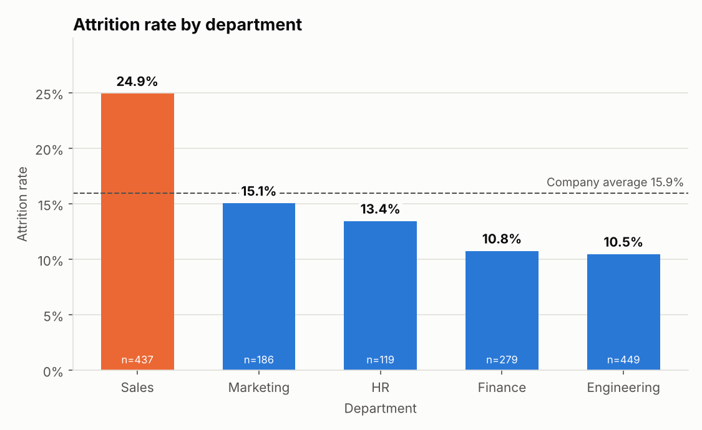
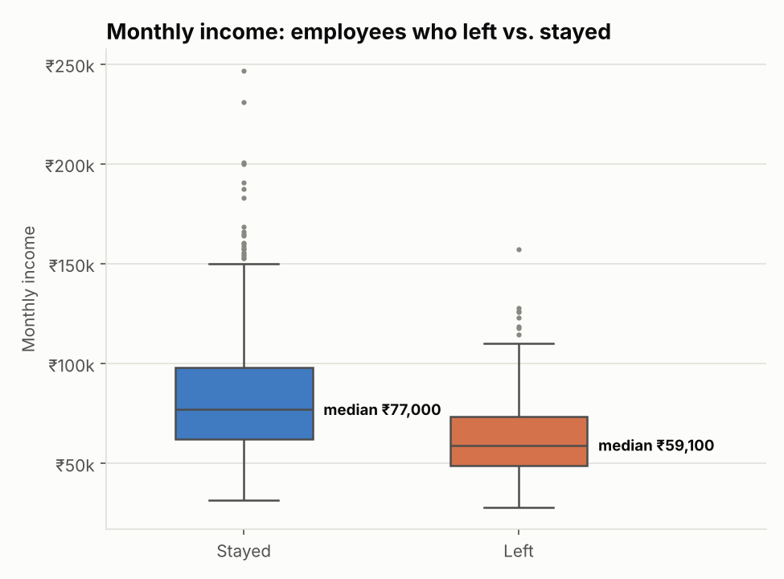
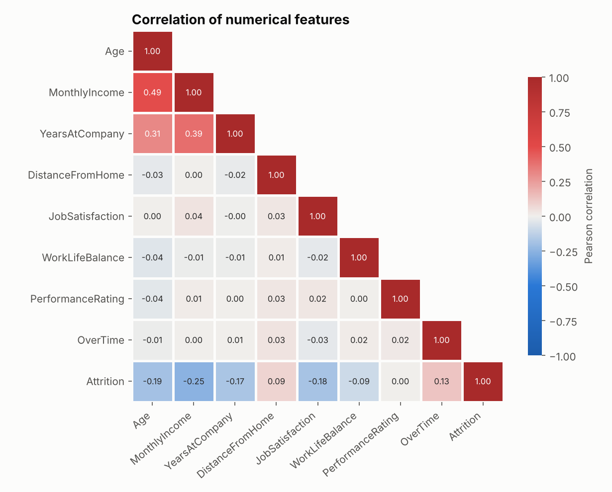
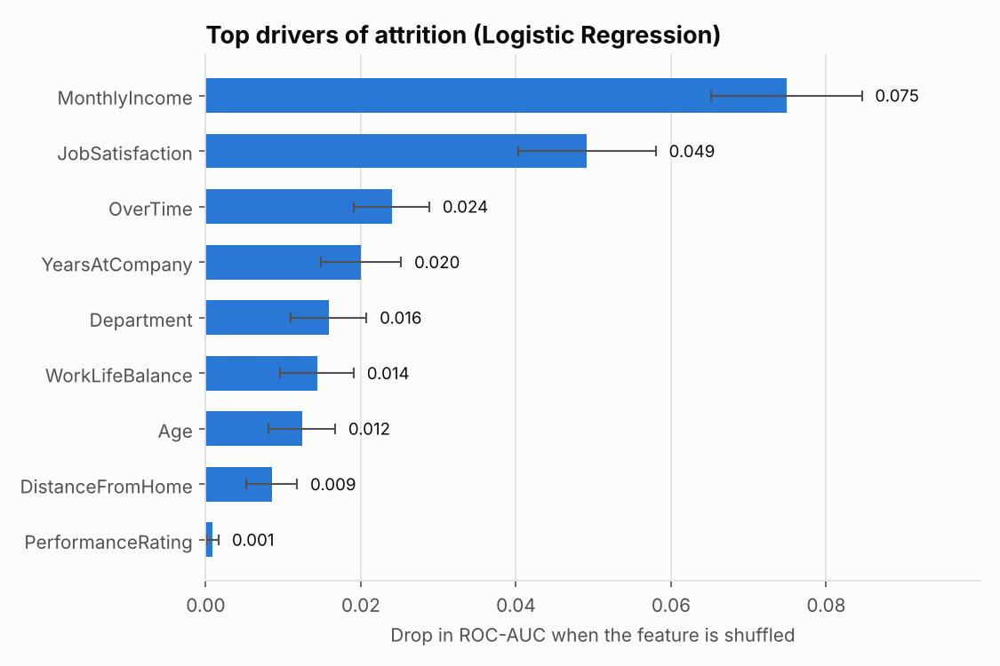

# Employee Attrition Prediction System

An end-to-end machine-learning project that predicts whether an employee is likely to leave a company, based on workplace, performance and demographic factors. It covers the whole pipeline: synthetic HR data → cleaning → EDA → preprocessing → model tuning and comparison → saved model → console and Streamlit prediction interfaces.

## Project Overview

* **Goal:** flag employees at risk of leaving so HR can act early.
* **Task:** binary classification (`Attrition` = Yes / No) on imbalanced data (~16% leavers).
* **Output:** predicted label (Yes/No), probability of leaving, and a Low / Medium / High risk band.
* **Web app:** a Streamlit dashboard backed by a **SQLite database** where you can add, edit, delete, import and export employees, rank the workforce by attrition risk, and retrain the model on your own data.
* **Highlights**
  * Modular code (`preprocessing`, `train_model`, `predict`, `eda`, `visualization`, `utils`), no giant scripts.
  * No data leakage: all imputers, scalers and encoders (and SMOTE, if used) are fitted inside a pipeline on training folds only.
  * Three models tuned with cross-validation, compared on five metrics, best one chosen on cross-validated score.
  * Strict input validation and clear errors for bad inputs, missing or corrupted model files.
  * Bonus: Streamlit web app with a SQLite employee database, XGBoost, SHAP explanations, SMOTE option, 45 automated tests, executed notebook.

## Technologies Used

| Area | Tools |
|---|---|
| Core | Python 3.10+ (tested on 3.13), Pandas, NumPy, Scikit-learn |
| Visualization | Matplotlib, Seaborn |
| Advanced modeling | XGBoost, imbalanced-learn (SMOTE) |
| Explainability | SHAP |
| Interface | Console (argparse / interactive), Streamlit web app |
| Persistence | SQLite (`data/employees.db`), Joblib (`models/best_model.pkl`) |
| Quality | Pytest, Jupyter |

## Dataset Description

`data/employee_data.csv` is generated by `src/generate_data.py` (1,500 employees, fixed seed). Attrition is drawn from a logistic model whose drivers mirror common HR findings (overtime, low satisfaction, low pay, short tenure, long commute), calibrated to ~16% attrition so the classes are imbalanced.

| Column | Description |
|---|---|
| `EmployeeID` | Unique identifier (dropped before modeling) |
| `Age` | Employee's age |
| `Department` | Sales / Engineering / HR / Marketing / Finance |
| `MonthlyIncome` | Salary in ₹ |
| `YearsAtCompany` | Tenure in years |
| `JobSatisfaction` | Score 1–5 |
| `WorkLifeBalance` | Score 1–5 |
| `PerformanceRating` | Score 1–5 |
| `OverTime` | Yes / No |
| `DistanceFromHome` | Distance in km |
| `Attrition` | **Target**: Yes / No |

The raw file deliberately includes realistic mess so the cleaning step has real work to do: ~2–3% missing values in several columns, inconsistent text (`" sales "`, `ENGINEERING`, `yes`) and a handful of impossible values (age −1, satisfaction 9, negative income or distance). Use `python -m src.generate_data --clean` for a pristine file.

## Project Structure

```
Employee-Attrition-Prediction/
├── app.py                      # Streamlit web app (dashboard + employee manager)
├── .streamlit/config.toml      # app theme
├── data/
│   ├── employee_data.csv       # raw synthetic dataset used by the ML pipeline
│   └── employees.db            # SQLite database, auto-created on first run of the app
├── notebooks/EDA_and_Modeling.ipynb   # executed walkthrough
├── src/
│   ├── generate_data.py        # synthetic dataset
│   ├── preprocessing.py        # loading, cleaning, imputing, encoding, scaling
│   ├── eda.py                  # attrition rates, correlations, top factors
│   ├── visualization.py        # all plots
│   ├── train_model.py          # tuning, comparison, selection, saving
│   ├── database.py             # SQLite layer: add / edit / delete / import / export
│   ├── insights.py             # "why is this score high?" explanations
│   ├── predict.py              # validation + predictor + console interface
│   └── utils.py                # paths, constants, logging
├── models/                     # best_model.pkl, model_comparison.csv, metrics.json
├── visuals/                    # saved charts + eda_summary.md
├── tests/                      # pytest suite
├── requirements.txt
└── README.md
```

## The Web App and Database

Start it with `streamlit run app.py`. On first launch it creates `data/employees.db` and fills it with 1,500 sample employees so there is something to show immediately.

| Tab | What it does |
|---|---|
| **Dashboard** | Headcount, attrition rate, high-risk count, and charts by department, overtime, job satisfaction and risk level |
| **Employees** | Searchable, filterable table. **Add**, **Edit** (select one row), **Delete** (select one or more, with confirmation), **Import from CSV**, **Export**, plus a danger zone to wipe the sample data or restore it |
| **Risk Scan** | Active employees ranked by predicted attrition risk, with the main factors behind each score; downloadable as CSV |
| **What-if Predictor** | Enter or pre-fill a profile and see the probability and a chart of what raises or lowers it |
| **Model** | Metrics, model comparison and charts, plus a **Retrain** button that retrains on the employees in the database |

**Using your own employees**

1. Open the **Employees** tab, expand **Danger zone**, tick the confirmation and press **Delete ALL employees** (this removes the sample data).
2. Add people one by one with **➕ Add**, or bulk-load them with **Import from CSV**. Required columns: `Age, Department, MonthlyIncome, YearsAtCompany, JobSatisfaction, WorkLifeBalance, PerformanceRating, OverTime, DistanceFromHome`. Optional: `Name`, `Attrition` (Yes = the person has left). Invalid rows are skipped and listed with the reason.
3. Set **Status** to *Left* for people who have actually left. This is the label the model learns from.
4. Once you have at least 200 employees with at least 20 who left and 20 who stayed, open the **Model** tab and press **Retrain model now** (about 30 seconds). Until then, predictions use the model trained on the sample data.

Every write is validated (age 18-70, positive income, scores 1-5, known departments, tenure consistent with age) and the table also has database-level CHECK constraints, so invalid data cannot be stored. The database path can be changed with the `EMPLOYEE_DB_PATH` environment variable; `python -m src.database --reset | --empty | --export out.csv` manages it from the command line.

**Reading the risk score.** Scores come from a model trained with class weighting, so they are inflated compared with the real ~16% base rate. Treat them as a ranking (who is riskier than whom) rather than a literal chance of leaving. Risk levels: Low < 30%, Medium 30-60%, High 60% or more.

## How the Pipeline Works

1. **Cleaning** (`clean_data`): normalises text, turns impossible values into missing values, drops duplicate IDs. It learns nothing from the data, so it is safe to run before splitting.
2. **Split:** stratified 80/20 train/test, so both keep the same attrition rate.
3. **Preprocessing** (`ColumnTransformer`, fitted on training data only):
   * numeric features → median imputation → standard scaling
   * `MonthlyIncome` (right-skewed) → median imputation → `log1p` → standard scaling
   * `Department` → most-frequent imputation → one-hot encoding (unknown values ignored at prediction time)
   * `OverTime` → most-frequent imputation → 0/1 encoding
4. **Class imbalance:** class weighting by default (`class_weight="balanced"`, `scale_pos_weight` for XGBoost). `--imbalance smote` switches to SMOTE applied inside each CV training fold (imblearn pipeline), so validation folds never contain synthetic rows.
5. **Tuning:** 5-fold stratified CV optimising ROC-AUC. Grid search for Logistic Regression, randomised search (20 draws) for Random Forest and XGBoost.
6. **Evaluation:** every tuned model is scored once on the untouched test set (accuracy, precision, recall, F1, ROC-AUC).
7. **Selection:** highest **cross-validated** ROC-AUC, so the test set stays an unbiased estimate.

## Model Performance Comparison

Test-set results (300 employees, 48 leavers), class weighting, decision threshold 0.5:

| Model | CV ROC-AUC | Accuracy | Precision | Recall | F1 | ROC-AUC |
|---|---|---|---|---|---|---|
| **Logistic Regression** (selected) | **0.786** | 0.727 | 0.330 | **0.688** | 0.446 | **0.777** |
| Random Forest | 0.773 | **0.770** | **0.356** | 0.542 | 0.430 | 0.766 |
| XGBoost | 0.766 | 0.737 | 0.337 | 0.667 | **0.448** | 0.757 |

Best hyper-parameters: Logistic Regression `C=0.1`; Random Forest `n_estimators=221, max_depth=12, min_samples_leaf=11, max_features=sqrt`; XGBoost `n_estimators=185, max_depth=4, learning_rate≈0.013` (full values in `models/metrics.json`).

**SMOTE instead of class weighting** (`--imbalance smote`) gave a very similar Logistic Regression (test ROC-AUC 0.771, F1 0.449) but weaker tree models (Random Forest recall 0.40, XGBoost recall 0.48), so class weighting stays the default.

### Why Logistic Regression was selected

* It has the highest cross-validated ROC-AUC (0.786 vs 0.773 for Random Forest), and the same ordering holds on the test set (ROC-AUC 0.777 vs 0.766 vs 0.757).
* ROC-AUC measures how well the model ranks leavers above stayers regardless of threshold, which suits imbalanced data where accuracy is misleading (always predicting "stays" would score ~84% accuracy).
* It catches about 69% of leavers (recall 0.69). Precision of 0.33 means roughly one in three flagged employees actually leaves, double the 16% base rate. HR can raise the threshold for fewer, more certain flags.
* It is the simplest and most interpretable model, and the fastest to train and score.

**Honest caveat:** the data is synthetic and generated from a roughly linear risk model with built-in randomness, so a regularised linear model is naturally hard to beat and AUC tops out near 0.78. On real HR data, tree ensembles may overtake it; this pipeline makes that easy to re-check (`python -m src.train_model`). The differences between the three models are also small relative to the noise of a 300-row test set.

## Key Insights from EDA

* **Overall attrition is 15.9%** (239 of 1,500), so the classes are imbalanced.
* **Sales loses the most people** (24.9%); Engineering the fewest (10.5%).
* **Overtime nearly doubles attrition:** 23.0% with overtime vs 12.9% without (1.8×).
* **Job satisfaction is a strong signal:** attrition falls from 30.8% at score 1 to 9.5% at score 5.
* **Pay matters:** median income is ₹59,100 for leavers vs ₹77,000 for stayers (−23%).
* **New joiners are most at risk:** 34.8% attrition up to 1 year of tenure vs 11.7% after 5+ years.
* **Top factors**: by EDA rank (|correlation| + mutual information): MonthlyIncome, Age, Sales department, YearsAtCompany, JobSatisfaction. By the trained model (permutation importance): MonthlyIncome, JobSatisfaction, OverTime, YearsAtCompany, Department. `PerformanceRating` has essentially no effect.
* **Income, age and tenure are correlated** (0.31–0.49), so their individual effects overlap; the model weighs them jointly.

Full tables are in `visuals/eda_summary.md`.

### Visualizations (`visuals/`)

| | |
|---|---|
|  |  |
|  |  |

Also saved: attrition by overtime and by job satisfaction, correlation with attrition, ROC curves, confusion matrix and a SHAP summary plot.

## How to Run the Project

```bash
# 1. Install dependencies (Python 3.10+)
python -m venv .venv && source .venv/bin/activate      # Windows: .venv\Scripts\activate
pip install -r requirements.txt

# 2. Generate the dataset
python -m src.generate_data

# 3. Exploratory analysis and plots
python -m src.eda

# 4. Train, tune, compare and save the best model (about 1 minute)
python -m src.train_model                       # class weighting (default)
python -m src.train_model --imbalance smote     # use SMOTE instead

# 5a. Predict in the console (interactive prompts)
python -m src.predict

# 5b. ...or in one command
python -m src.predict --age 29 --department Sales --monthly-income 42000 \
    --years-at-company 1 --job-satisfaction 2 --work-life-balance 2 \
    --performance-rating 3 --overtime Yes --distance-from-home 25

# 5c. Streamlit web app with the employee database (recommended)
streamlit run app.py

# 6. Tests and notebook (pip install -r requirements-dev.txt first)
python -m pytest
jupyter notebook notebooks/EDA_and_Modeling.ipynb
```

Run all commands from the project root. Example output:

```
====================================================
  Predicted attrition : Yes  (LIKELY TO LEAVE)
  Probability of leaving: 99.6%
  Risk level          : High
  Model               : Logistic Regression (threshold 0.50)
====================================================
```

Add `--json` for machine-readable output. Exit codes: `0` success, `1` model/file error, `2` invalid input.

## Error Handling

* **Input validation** (`validate_employee_input`): rejects non-numeric, NaN or blank values, age outside 18–70, income ≤ 0 or unrealistically high, negative tenure or distance, scores that are not whole numbers 1–5, unknown departments and invalid overtime values. It also catches inconsistent combinations (tenure longer than working life). All problems are reported together, and the console re-prompts until each answer is valid.
* **Data problems:** missing columns, empty or malformed CSVs give clear errors; missing and impossible values are imputed inside the pipeline (never dropped silently); unseen department values are ignored by the encoder.
* **Model loading:** a missing, corrupted or incompatible `best_model.pkl` raises a clear message telling the user to retrain; the Streamlit app shows the same message instead of crashing.

## Limitations and Next Steps

* Synthetic data: real-world performance needs real HR data and a fairness review before any decision about people is automated. Predictions should support, not replace, human judgement.
* Decision threshold is fixed at 0.5; it could be tuned to the cost of missing a leaver versus a needless retention conversation.
* Ideas: calibrate probabilities, add LightGBM, track experiments, package the predictor as an API.

## Web app and deployment

`streamlit run app.py` opens a five-page app (Overview, People, Risk radar, What-if lab, Model) with a light and a dark theme (toggle in the top bar, or `?theme=dark` in the URL). The workspace switcher in the top bar is presentational; the name and branding live in `ui/config.py`.

**Deploy on Streamlit Community Cloud** (free): push the repo to GitHub, open share.streamlit.io, pick the repo, branch `main`, main file `app.py`. Commit `models/best_model.pkl`, `models/metrics.json`, `static/` and `.streamlit/config.toml`. Vercel is not suitable: it cannot run a long-lived Streamlit server. The SQLite file resets when the host restarts; the app re-seeds the sample employees.
